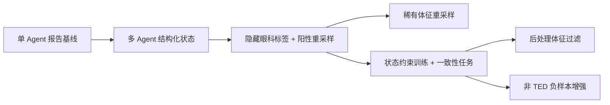

# TED 多智能体 VLM：从报告生成到证据一致性的实验复盘

**一个已结项的小样本研究记录，整理于 2026-10-14。**

本项目围绕甲状腺眼病（TED）相关的多模态报告生成展开。最初的问题是“模型能否结合图像与临床文本生成报告”，随后收敛为：**最终报告与中间专科状态是否一致？更高的报告分数是否掩盖了证据层的问题？**

公开版保留研究思路、实验设计、汇总结果、失败经验与评价局限。它是研究复盘，不是已经完成临床验证的诊断产品，也不是可直接复现实验的代码或数据发布。

## 三分钟读懂研究路线



这张图是按问题组织的回顾路线，不是逐次实验的精确时间线，也不表示每个版本从前一个版本的权重继续训练。

1. **A → B：报告质量与中间证据需要分别评价。** B 的最终报告体征 F1 为 0.706，而眼科状态 F1 仅为 0.133。
2. **B → C1：改变眼科输入和采样策略。** 严格隐藏眼科诊断标签的 C1 评估中，眼科状态 F1 为 0.778，报告与状态的不一致比例由 B 的 0.477 降到 0.205。
3. **C2：找回稀有体征有代价。** 某稀有体征状态 F1 从 0 提高到 0.333，但最终报告 F1 降为 0.607。
4. **C3：报告指标变高，负控代理指标也变高。** 报告 F1 为 0.847；内部非 TED 样本的相关阳性体征出现比例为 0.867。
5. **C3-filtered：约束输出接受规则。** 报告体征 F1 降为 0.776，观察到的不一致比例为 0；这只是体征级过滤，没有重写原报告。
6. **C4：保留没有达到预期的尝试。** 负样本增强部分降低了阳性体征出现比例，但报告 F1 和一致性均未达到理想的综合表现。

以上为小样本描述性结果，不能据此确认因果、统计显著性、外部泛化或临床安全性。

## 阅读导航

| 想了解什么 | 阅读入口 |
|---|---|
| 问题为什么这样定义 | [研究问题](docs/research-question.md) |
| 方法如何逐步演进 | [方法演进](docs/method-evolution.md) |
| 实验如何设计、如何控制版本 | [实验设计](docs/experiment-design.md) |
| 指标怎么算，有什么陷阱 | [指标定义](docs/metric-definitions.md) |
| 完整结果和取舍 | [结果分析](docs/results-and-analysis.md) |
| 哪些尝试没有奏效 | [失败与经验](docs/failures-and-lessons.md) |
| 哪些结论还不能下 | [局限与后续验证](docs/limitations-and-next-steps.md) |
| 内容依据与公开边界 | [来源与发布范围](docs/provenance-and-scope.md) |
| 可机器读取的汇总表 | [results/](results/README.md) |

## 核心实验设置

- 基座：Qwen2-VL-2B-Instruct；角色通过提示与任务监督区分，共享基座并使用 LoRA。
- 原始病例划分：101 条训练记录、26 条留出记录；留出集中 11 条 TED、15 条非 TED。
- 主要体征级 F1 在 11 条 TED 子集上计算；不一致比例按 11 × 4 个体征决策计算。
- 内部负控代理指标在 15 条非 TED 样本上计算；非 TED 标签本身不等于四种体征全部阴性。
- C1 的隐藏标签仅针对眼科角色；报告/临床角色仍可接触诊断标签。这里研究的是给定部分标签条件下的报告生成，不能视为盲诊断评测。

## 公开内容边界

本仓库仅含重新撰写的文档和聚合指标。没有患者图像、表格、逐例报告、病例编号、模型权重、服务配置、密钥、原论文全文或第三方源码。没有使用真实病例改写的演示样例。

临床数据和完整内部材料不通过此仓库提供；公开汇总也不能替代独立审计。详细限制见 [发布范围](docs/provenance-and-scope.md)。

## 检查文档

本仓库无推理服务或第三方依赖。在 Python 3 环境中运行：

```bash
python3 tools/validate_publication.py
```

该命令检查相对链接、发布文件范围、表格一致性与常见敏感内容模式；不运行原模型，也不验证临床结论。
