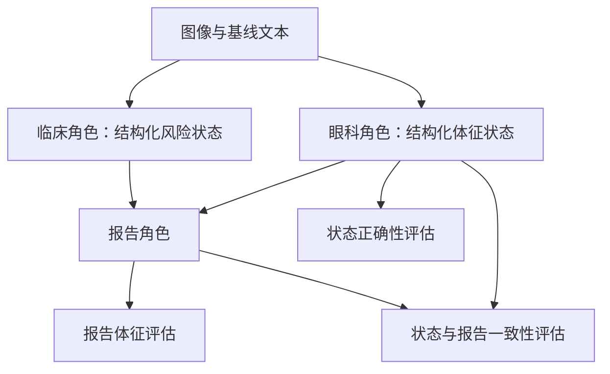

# 研究问题：让报告背后的状态可检查

## 起点

研究任务是把图像与临床文本组织成报告。单模型直接生成报告可以作为起点，但只看文字相似度，难以知道模型究竟利用了哪一部分输入。

早期设想涉及眼科、内分泌、体检等科室视角，以及前置分类与分阶段报告。最终用于这组定量比较的主链路收敛为三个角色：眼科状态、临床/内分泌状态、报告生成。科室规划与已评估系统需要区分。

## 为什么拆分角色

设计动机是把视觉体征与临床风险信息显式拆开，再交给报告角色整合。这样可以分别检查状态质量与状态到报告的传递情况。

角色拆分是一种可检查的设计，不自动说明模型真的只用了指定证据。共享模型、输入中仍有标签、基线文本可能描述体征等因素，都限制了这种解释。

## 三个核心问题

1. **状态是否准确？** 专科 JSON 可以语法正确，却漏掉真实阳性体征。
2. **报告是否忠实于状态？** 报告可能加入状态没有标为阳性的体征；也可能遗漏状态中的阳性。
3. **状态本身如果错误怎么办？** 忠实于错误状态的报告仍然可能错误，因此一致性与正确性必须分开。

B 的结果使第三层之外的中间状态问题变得突出：最终报告 F1 比状态 F1 高，并不足以说明报告真正建立在可靠的中间证据上。由此产生“隐藏眼科标签、增加状态监督、检查报告一致性”的后续实验路线。

## 研究目标如何收敛

最初目标偏向报告生成，复盘时更有证据支持的目标是：**在小样本条件下，比较角色化状态监督、采样策略和输出过滤对体征提取与报告一致性的影响。**

这里不主张系统首次提出某类方法，不主张已经完成临床部署，也不把高规则评分等同于医生评审通过。
